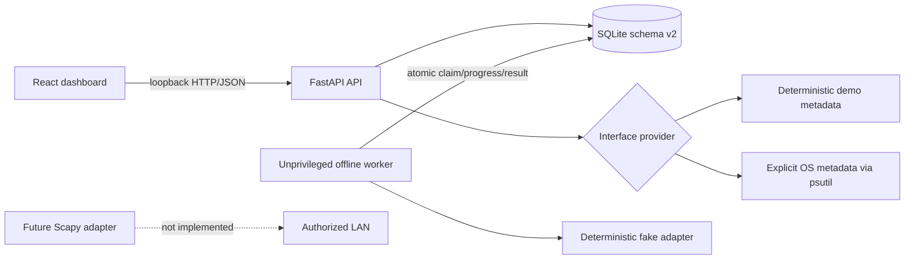

# Architecture

## Milestone 3 runtime

The API and worker are independent processes. The API never spawns or
privileges a worker. Neither process imports Scapy. The only executable adapter
is deterministic and offline; its observations use the `demo_discovery` source
namespace, separate from the original `demo` inventory fixtures.

## Interface and scope boundary

`InterfaceProvider.list_interfaces()` returns an allowlisted model: stable
identifier, name, IPv4 address/netmask/network tuples, state where available,
loopback status, source, and eligibility. Demo mode returns fixed fixtures.
`local_metadata` is a separate explicit setting and reads only `psutil`
interface addresses and statistics. It does not use interface names to infer
Wi-Fi versus wired, inspect routes, run commands, or initiate traffic.

`validate_scope()` parses addresses with Python `ipaddress`, identifies one
current interface address, and requires a canonical RFC1918 IPv4 network fully
contained in that address's connected network. Loopback, link-local,
multicast, public, IPv6, ambiguous, malformed, down-interface, and scopes over
256 addresses fail with bounded user-facing errors. Validation occurs on job
submission and again against fresh provider metadata after worker claim.
Local-metadata scopes can be inspected and validated, but cannot create an
executable job in this milestone.

## SQLite ownership and migration

Schema version 1 remains the inventory and presence history. Forward-only
schema version 2 adds `discovery_jobs` and indexes; it does not rewrite or
delete existing records. Job scope is snapshotted as source, interface ID,
selected IPv4 address, and target CIDR.

A partial unique index permits only one `queued` or `running` job. Creation,
claim, progress, cancellation, completion, failure, and lease recovery use
short SQLite transactions and legal-state predicates. The deterministic job
order is `(created_at DESC, id DESC)`. Terminal retention keeps the configured
newest count and never removes active work.

Workers claim with an owner ID and expiring lease. An expired running job is
marked `failed/worker_lost` by a later claim attempt and is not rerun. This
avoids silently repeating partially executed future adapters. Queued
cancellation is immediately terminal. Running cancellation sets a durable flag
which the adapter observes cooperatively.

Adapter execution is outside database transactions. Only a complete result set
is ingested, in the same transaction that marks the job completed. Failed and
cancelled jobs ingest nothing. SQLite `BEGIN IMMEDIATE` serializes both manual
inventory refresh and discovery ingestion across processes. The shared
observation application preserves `custom_name`; unseen devices are untouched,
so absence never creates an offline event.

## HTTP and dashboard

The dashboard explicitly labels discovery as synthetic and offline. It exposes
interface/address/network selection, scope guidance, queued-versus-running
state, bounded progress, cancellation, failures, and the newest ten jobs. It
polls once per second only while the current job is active, clears the interval
on unmount, and reloads inventory after completion. A queued job honestly means
the separate worker has not claimed it.

The API binds to loopback by default and retains an explicit local CORS
allowlist. Middleware rejects unexpected Host values and untrusted Origin
values on mutations. Origin-less requests remain available to same-machine CLI
clients. These browser-focused controls are not authentication and do not make
remote exposure safe.

## Inventory semantics

Provider identity is unique within a source namespace. `provider_name` and
`custom_name` remain separate. Positive online observations advance
`last_seen`; missing observations do nothing. Presence history records initial
and changed statuses, not packets or traffic, and stays bounded per device.

## Future boundaries

Milestone 4 may add an explicitly enabled Scapy ARP adapter without changing
the job API. That adapter must still use a selected validated scope and must not
run in the API. Packet capture, default-route discovery, startup scanning,
OpenWrt/Pi-hole enforcement, cloud login, and remote access are not implemented.
Enforcement must remain separate from observation and retain planning,
verification, audit, and rollback semantics.
