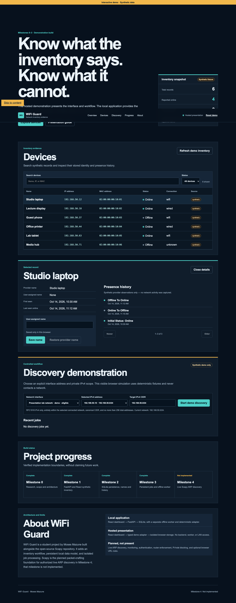
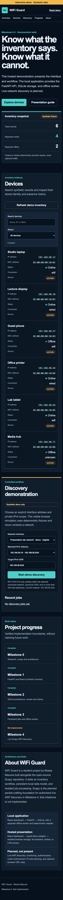

# WiFi Guard progress report

**Student:** Moses Mazune
**Project:** WiFi Guard
**Implementation status:** Milestones 0–3 complete; Milestone 4 not implemented
**Report date:** 16 October 2026

## Executive summary

WiFi Guard is a local-first network inventory project designed to help an
authorized network operator maintain clear, evidence-based device records. The
current application demonstrates inventory, search and filtering, device
details, custom names, presence history, and persistent discovery-job
workflows using deterministic synthetic data. It does not discover, monitor,
or block real devices.

The local application uses a React and TypeScript dashboard, a FastAPI service,
SQLite storage, and a separate unprivileged worker. A hosted presentation build
uses the same interface with a typed demo-service adapter. Its data and edits
remain inside each visitor's browser. The hosted build does not run FastAPI,
SQLite, or the worker and does not access the visitor's network.

## Problem statement

Small network operators often lack a simple record of which devices have been
observed, how those records change, and what evidence supports a displayed
status. A useful solution must distinguish inventory evidence from traffic
monitoring and policy enforcement. It must also avoid overstating what an ARP
response, a missing response, or a device address can prove.

## Aim and objectives

The aim is to build WiFi Guard as a safe, understandable device-inventory and
future network-control interface for authorized networks.

The current objectives are to:

1. present deterministic synthetic device records without touching a network;
2. persist inventory, custom names, and presence-state changes locally;
3. validate an explicitly selected interface address and private IPv4 scope;
4. process synthetic discovery through a durable job model and separate worker;
5. communicate implemented and planned capabilities accurately; and
6. establish a bounded adapter design for later authorized Scapy discovery.

## Scapy and WiFi Guard

[Scapy](https://scapy.net/) is an open-source Python packet manipulation
library. It can construct, send, receive, dissect, and inspect network packets.
Its documented features include ARP-based discovery helpers and packet
sniffing. Those capabilities can require appropriate privileges and must be
used only on networks the operator is authorized to administer.

WiFi Guard adds the application-level workflow around the upstream library: a
dashboard, typed API, durable inventory, presence history, explicit scope
validation, persistent discovery jobs, cancellation, worker leases, and clear
capability boundaries. The current worker uses only a deterministic fake
adapter. No WiFi Guard process currently imports Scapy or performs packet I/O.

## Architecture

### Local application

```text
React dashboard -> loopback HTTP/JSON -> FastAPI -> SQLite
                                              ^
Separate offline worker -> deterministic adapter -> transactional ingestion
```

The API and worker are independent processes. SQLite schema migrations preserve
the inventory while adding the job model. A partial unique index permits one
queued or running job. Claims, progress, cancellation, leases, failure, and
completion use legal-state predicates and short transactions. Completed
results and inventory changes commit together; failed or cancelled jobs ingest
no partial observations.

### Hosted presentation

```text
React dashboard -> typed hosted-demo adapter -> browser local storage
```

The presentation build is selected explicitly with `VITE_DATA_MODE=hosted`.
It never silently replaces a failed API call with fixtures. The adapter uses
deterministic records, visibly simulates a discovery lifecycle, supports
cancellation, saves optional names only in the current browser, and provides a
reset action. Invalid or unavailable browser storage degrades to temporary
in-memory state with a visible notice.

## Completed milestones

- **Milestone 0:** upstream Scapy provenance, licensing review, problem scope,
  evidence limits, and architecture documentation.
- **Milestone 1:** independently installable FastAPI backend and React/Vite
  dashboard with deterministic inventory, capability reporting, search,
  filtering, and explicit failure states.
- **Milestone 2:** forward-only SQLite migration, persisted inventory, custom
  device names, bounded presence history, refresh transactions, details, and
  pagination.
- **Milestone 3:** interface providers, IPv4 scope validation, durable jobs,
  atomic claiming, leases, cancellation, crash recovery, separate worker,
  deterministic adapter, transactional ingestion, and Host/Origin protections.
- **Milestone 4: Not implemented.** No real ARP discovery has been added.

## Current demonstration capabilities

- search synthetic devices by name, IPv4 address, or MAC address;
- filter by reported online/offline state;
- inspect provider names, optional custom names, timestamps, and history;
- edit or clear custom names;
- select an explicit synthetic interface, IPv4 address, and private CIDR;
- run a visible deterministic discovery simulation or cancel it;
- inspect current and recent job states; and
- reset hosted visitor-local changes.

## Current limitations and remaining work

The project currently provides no real discovery, packet capture, traffic
monitoring, authentication, remote multi-user service, firewall change, DNS
change, OpenWrt control, Pi-hole integration, or exact URL filtering. Reported
presence comes from synthetic provider observations and is not packet evidence.

Remaining work includes authorized live ARP discovery, monitoring from an
appropriate observation point, authentication and hardening, router-based
device/IP enforcement, Pi-hole domain blocking, optional managed-browser URL
filtering, and final controlled evaluation. IPv6 Neighbor Discovery, randomized
MAC addresses, client isolation, sleeping devices, VPNs, and encrypted DNS must
remain explicit coverage limits.

## Current testing evidence

Checks run on 16 October 2026:

| Check | Result |
| --- | --- |
| Backend pytest suite | 39 passed; one dependency deprecation warning |
| Frontend Vitest suite | 13 passed across 3 test files |
| TypeScript project check | Passed |
| API-mode production build | Passed |
| Hosted-mode production build | Passed |
| Hosted adapter focused tests | Passed: persistence/reset, completion, cancellation, no fetch |
| Browser interaction check | Passed: navigation, filtering, details, naming, refresh persistence, completion, cancellation, reset |
| Mobile viewport check | 390 × 844; no horizontal overflow |
| Browser console | No warnings or errors during tested hosted flows |

The backend test environment emitted a Starlette deprecation warning about its
current TestClient/httpx compatibility. It did not fail a test.

## Screenshots

### Hosted overview


### Device details and full workflow



### Mobile layout



## Source, licensing, and attribution

The working repository preserves the official Scapy history from
[`secdev/scapy`](https://github.com/secdev/scapy) at commit
`5376fcc86aaba7c516fb4aa19576b03b387d217a`. Scapy code and tools retain the
upstream GPL-2.0-only notices; its documentation has separate notices described
in the repository. WiFi Guard work is isolated under `tools/wifi_guard/` and
does not claim authorship of Scapy.

Primary references:

- [Scapy introduction](https://scapy.readthedocs.io/en/stable/introduction.html)
- [Scapy usage guide](https://scapy.readthedocs.io/en/stable/usage.html)
- [RFC 826: Address Resolution Protocol](https://www.rfc-editor.org/info/rfc826)
- [RFC 4861: IPv6 Neighbor Discovery](https://www.rfc-editor.org/rfc/rfc4861.html)

## Published project

- GitHub: _added after publication_
- Hosted demonstration: _added after deployment_
